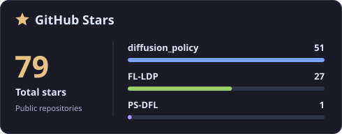

<table border="0">
  <!-- <tr> -->
    <td width="57.5%" valign="top">
      

        
      

      <!-- 

        🔭 <b>Current Focus</b>: Diffusion Policy & MuJoCo Simulation
      
 -->
      <!--   -->
      

      <!-- <b>📊 GitHub Stats</b> -->
      <!--   -->
      
      

        
        
      

      

        
      

      

      <!-- 

        
        
        
      
 -->
    </td>
    <td width="42.5%" align="center" valign="top">
      
      

        
      

    </td>
  
  <!-- </tr> -->
</table>
